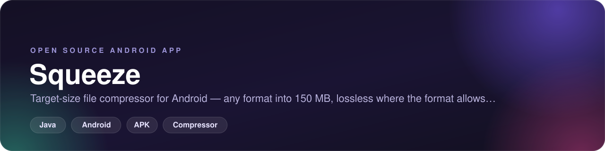
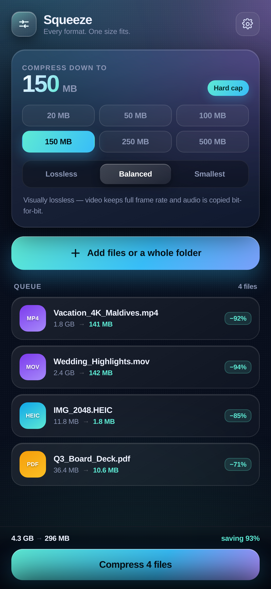
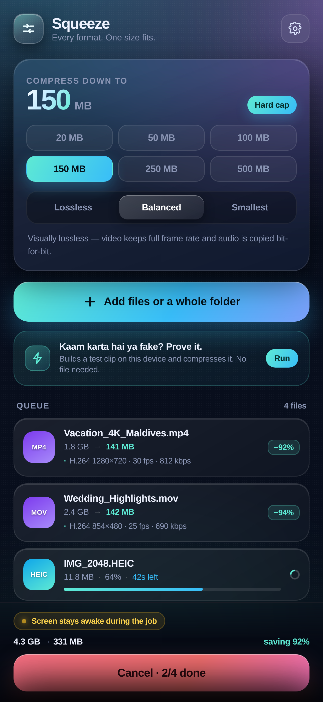
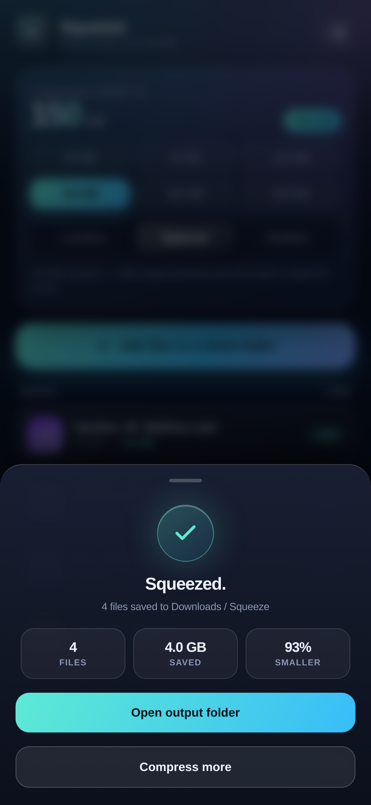
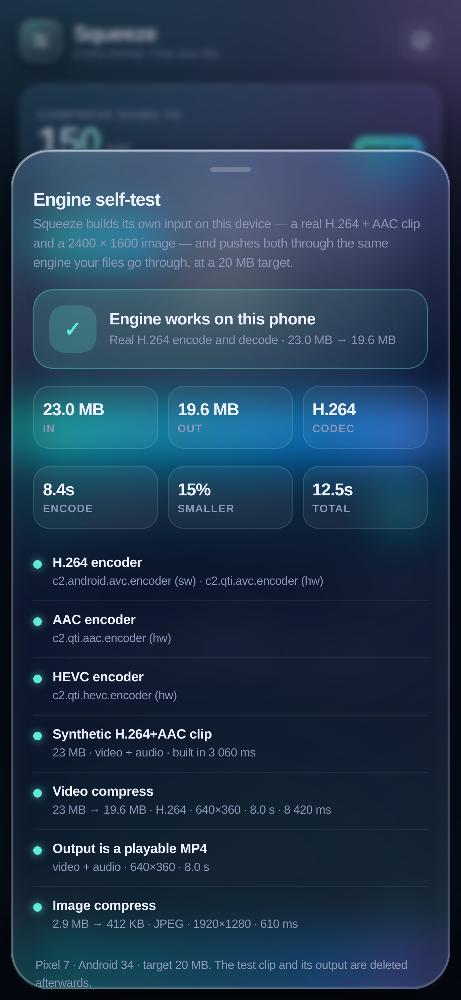
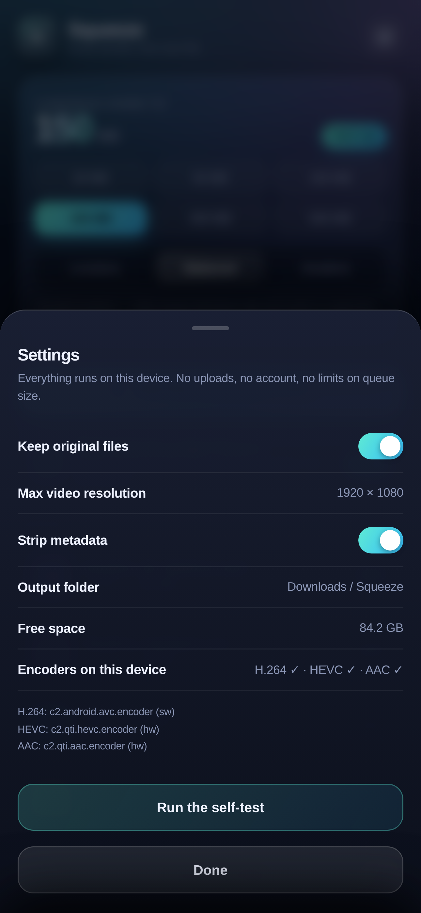

<div align="center">




<a href="https://github.com/technicalnihilist-lgtm/squeeze-compressor/stargazers"></a>&nbsp;<a href="https://github.com/technicalnihilist-lgtm/squeeze-compressor/network/members"></a>

<a href="https://github.com/technicalnihilist-lgtm/squeeze-compressor/releases/latest"></a>

<b>Support the work</b>

  

<sub>Donations aren't live yet — Paytm, UPI, PayPal and Buy&nbsp;Me&nbsp;a&nbsp;Coffee all show <b>coming soon</b>. Until then, a ⭐ star is the best support.</sub>

<a href="https://github.com/technicalnihilist-lgtm/squeeze-compressor/releases/latest"></a>  <a href="https://github.com/technicalnihilist-lgtm/squeeze-compressor/releases"></a>

</div>

---

## Screenshots

| Queue &amp; target size | Compressing (cancel + live note) | Done |
|---|---|---|
|  |  |  |

| Self-test | Settings |
|---|---|
|  |  |

## Cancel, share, and pick up where you left off

A long transcode is easy to start and hard to take back, so cancel is real rather than cosmetic. While a job runs the main button turns into **Cancel**; tapping it sets a flag that the worker checks between files *and* inside the encode loop itself, so a video transcode unwinds between two frames instead of running to the end. Half-written scratch files are deleted, pending entries are removed from `Downloads/Squeeze`, and every unfinished file goes straight back into the queue — ready to retry with a different target, no re-picking.

Each finished row also keeps the engine's own note: `H.264 1280×720 · 30 fps · 812 kbps`, `AAC 96 kbps`, `Lossless re-compression of 61 entries`, or `Smallest reachable is 38 MB` when the target was physically out of reach. It is the engine's measurement, not a decoration.

Squeeze registers itself as a share target and an "open with" handler, so **Share → Squeeze** from Gallery, Files or a chat app drops the file straight into the queue. The queue itself is kept across restarts — close the app mid-job, reopen it, and the same files are waiting. A share grant that expired in the meantime is dropped rather than failing later.

While a job is running a small pill in the footer says the screen stays awake, which reflects the actual wake lock: the display is held on and a partial wake lock keeps the CPU going, so a locked phone does not quietly stall the encoder.

## Motion you can dial down

The UI has two motion effects, and both are adjustable in **Settings → Motion & depth** rather than baked in.

The **4D depth effect** tilts the glass cards towards your finger (up to 6° at full strength) and slides a soft light across them, so the surface reads as layered instead of flat. **Parallax** moves the four backdrop blobs at their own rates — the nearest one travels furthest — both with your finger and as the queue scrolls, which is what gives the screen depth when the list is long.

Depth can also follow the phone itself (the gyro toggle) instead of only your finger, and every control has its own switch and strength slider — saved on the device and restored on the next launch.

**Bounce** is the third control: a real damped spring, sampled into a CSS `linear()` easing, so the app opening, the sheets rising and every button press share one physical feel that the strength slider tunes (0 = no overshoot, 100 = a lively ~20% overshoot). **Liquid glass** is the fourth: the sheets are translucent panels that float above the app, and the transparency slider decides how much of the app shows through them — the dark base, the white tint and the backdrop blur all move together, so the glass stays readable at every setting.

Everything is one `transform` per frame written into CSS custom properties, so nothing reflows and there is no measurable battery cost; if the system's "reduce motion" setting is on, all four start switched off instead of overriding it.

## Install

Download **[Squeeze.apk](Squeeze.apk)** and open it on your phone. Android 10 or newer. You may need to allow "install unknown apps" for your browser or file manager the first time.

Signed with a release key, so future builds install straight over this one.

## What it actually does

The honest version, format by format. There is no single "compress without losing anything" switch that works on every format — anyone who tells you otherwise is either lying or quietly re-encoding your video. Squeeze picks the right strategy per file and tells you which one it used.

| Format | Lossless mode | Balanced (default) | Smallest |
|---|---|---|---|
| **JPG / PNG / HEIC / WebP** | Re-encoded losslessly (WebP lossless / PNG). Pixels are bit-identical, metadata stripped. | Quality 82, downscaled to the resolution cap, stepped down until it fits the target. | Quality 58 and smaller dimensions. |
| **MP4 / MKV / MOV / WEBM** | Copies the file untouched if it already fits; otherwise high-bitrate H.264. | H.264 re-encode sized to your target, resolution stepped down to fit. **The audio track is copied bit-for-bit** when it already fits the budget. | Lowest resolution and bitrate that still looks fine on a phone. |
| **MP3 / M4A / FLAC / WAV / OGG** | Original samples preserved, untouched. | AAC at whatever bitrate the target allows. | Same, lower bitrate floor. |
| **ZIP / DOCX / XLSX / PPTX** | Unpacked and re-deflated at level 9. Truly lossless — the bytes inside are unchanged. | Same. | Same. |
| **PDF / anything else** | Wrapped in a maximum-deflate ZIP, or stored unchanged if that would make it bigger. | Same. | Same. |

Two rules it never breaks: it will not hand you a file bigger than the one you gave it, and it will not re-encode something that already fits your target — those come back copied untouched.

**On PDFs:** embedded images inside a PDF are not recompressed, because doing that properly needs a full PDF library and would change the document's rendering. Squeeze re-deflates the container. A PDF that is mostly scanned images will barely shrink; one with uncompressed content streams can drop a lot.

## Prove it works — the self-test

Every compressor claims a lot. Squeeze ships with a button that checks it, on your hardware, in about fifteen seconds.

Tap **Run** under the add button (or *Run the self-test* in Settings). The app then:

1. Lists the encoders this device actually reports — H.264, HEVC and AAC, with the codec name and whether it is hardware or software.
2. Encodes a real H.264 + AAC clip with `MediaCodec` — 640 × 360, CBR, about 24 MB — so the input is genuinely larger than the target.
3. Compresses a synthetic 2400 × 1600 PNG the same way.
4. Pushes both through `Engine.compress` at a **20 MB target**, exactly as it would a file you picked.
5. Re-opens the result with `MediaExtractor` to prove it is a playable MP4, not just bytes on disk.

You get a pass/fail card with the measured numbers: bytes in, bytes out, the codec that did the work, the encode time and the total time. If any step fails, the card fails and names the step — the self-test never reports a pass for work that did not happen.

The test's own input and output are written to scratch space and deleted afterwards, so running it does not clutter `Downloads/Squeeze`.

## Hitting the target

The 20 / 50 / 100 / 150 / 250 / 500 MB figure is a hard cap, not a wish. Four things make that true:

1. **The budget is split before encoding.** Audio is capped at a quarter of the target (and re-encoded down if it would eat more), and whatever is left becomes the video bitrate. A two-hour video will never quietly spend 900 MB on its audio track.
2. **Resolution follows the budget.** A bitrate alone cannot put 1080p into 20 MB, so the engine picks the highest resolution whose comfortable bitrate actually fits — 1920 → 854 → 480 — instead of producing mush at full size.
3. **Every attempt is measured.** The transcode runs, the finished file is read, and if it overshoots the next attempt is scaled by the *real* overshoot.
4. **The smallest honest result wins.** If even the bottom rung cannot reach the target, you get the smallest file the footage allows and a note telling you what that floor was — never a fake "done" with nothing to show for it.

Images do the same thing by walking quality and dimension down in steps. Archives and unknown types fall back to a plain copy if compression would grow the file.

### When a target is physically impossible

A two-hour film in 20 MB is about 22 kbps of video plus audio — below anything watchable, and below the container's own overhead. Squeeze does not pretend otherwise: it encodes to the lowest sane rung and reports `Smallest reachable is 38 MB`. Short clips hit 20 MB easily; length is the limit, not the format.

## Big files

Nothing is loaded into memory whole. Inputs are streamed in 64 KB chunks, video frames go through hardware codec surfaces, and audio samples spill to a temp file with an in-memory index. A 4 GB video and a 40 KB photo use the same code path — the only real limits are free disk space and how long you are willing to watch a progress bar.

Files are read through a file descriptor rather than a content URI, which is what makes multi-gigabyte selections from Downloads, an SD card or Google Drive work; and the finished output is written to scratch space first, then moved into Downloads/Squeeze, so a long transcode cannot leave a half-written file behind. Free space is checked before the job starts rather than discovered half-way through.

If something genuinely cannot be compressed, the queue row turns red and says why — "not enough space", "no video track", "smallest reachable is X". Nothing is ever reported as done when no file was produced.

The queue is unlimited, and it runs on two lanes: photos and archives go through a small pool of workers while one video or audio job takes the codec lane on its own thread. A batch of forty photos therefore does not sit idle behind a ten-minute transcode — the two finish in roughly the time of the slower one, not the sum. MediaCodec work stays strictly single-threaded on purpose: two simultaneous transcodes fight over the same hardware encoder and make both of them worse. The screen is kept awake and a wake lock is held while a job runs, so a long transcode does not get killed when the display sleeps.

## Speed

Three things decide whether a queue feels fast, and all three are deliberate:

- **A photo is decoded once.** The source is decoded a single time at the largest size the ladder needs; every later attempt is an encode of those same pixels, at a lower quality or after one in-place downscale of a reused bitmap. The old path re-opened and re-decoded the file for each quality step — on a 12 MP JPEG a decode costs about five encodes, and it was doing eight of them.
- **Work that cannot help is skipped.** A file that already fits the target and is already inside the resolution cap is copied untouched without a single pixel being decoded.
- **Progress knows how long it has left.** Every progress event carries a time-remaining estimate, measured from bytes processed per second where the byte count is real and from the job's own progress rate where it is not. The queue row shows `64% · 42s left` instead of a bar that sits still and looks stuck. When no honest estimate exists yet, no number is shown.

Memory is bounded rather than merely large: one decode plus one working bitmap per photo, one reusable sample buffer for a whole video encode, and one scratch array for a whole audio track — no per-frame allocations in any hot loop.

## Where files go

`Downloads/Squeeze`, via MediaStore, so they show up in Files, Gallery and any other app. No storage permission is requested — Android 10+ lets the app write to its own output folder without one. Files are written as *pending* and only published when complete, so you never see a half-finished file.

## Privacy

No `INTERNET` permission at all. The app physically cannot upload your files. No analytics, no account, no ads, no tracking.

## Build it yourself

No Gradle, no AndroidX, no dependencies — `aapt2`, `javac`, `d8` and `apksigner` directly. The whole app is about 2,300 lines, Java plus one HTML file.

```bash
export ANDROID_SDK_ROOT=/path/to/android-sdk    # needs platforms;android-34, build-tools;34.0.0
export JAVA_HOME=/path/to/jdk-17
bash android/build.sh                           # -> android/build/Squeeze.apk
```

GitHub Actions does the same thing on every push (`.github/workflows/build.yml`) and attaches the APK to the release when you push a `v*` tag.

```
android/
├── AndroidManifest.xml
├── build.sh                    # aapt2 + javac + d8 + apksigner
├── release.keystore            # demo signing key (password: squeeze123)
├── assets/index.html           # the entire UI — one file
└── java/com/squeeze/compressor/
    ├── MainActivity.java       # WebView shell, SAF picker, two worker lanes
    ├── Engine.java             # job model, MediaStore output, dispatch
    ├── Plan.java               # which jobs run in parallel, image ladder rules
    ├── Speed.java              # bytes/sec and time-remaining math
    ├── ImageCompressor.java    # one decode → reused bitmap → step quality
    ├── VideoCompressor.java    # MediaCodec surface transcode + target fitting
    ├── AudioCompressor.java    # AAC re-encode
    ├── AudioBag.java           # encoded-audio spool + AAC passthrough
    ├── Archiver.java           # ZIP / Office re-deflate, generic fallback
    └── SelfTest.java           # on-device H.264+AAC clip, test image, encoder list
```

The UI is a single HTML file talking to the engine over a small JS bridge (`Native.pickFiles`, `Native.start`, `Native.selfTest`, `Native.encoders`, `Sq.onProgress`, `Sq.onDone`, `Sq.onSelfTest`), which is also why the screenshots above are the real interface rendered at phone size rather than mockups.

## Licence

MIT — see [LICENSE](LICENSE).

---

---

## 🌍 Languages

<sub>Donations are <b>coming soon</b> in every language below — nothing to pay today, nothing to click.</sub>

<div align="center">

<sub><b>हिन्दी · বাংলা · मराठी · తెలుగు · தமிழ் · ગુજરાતી · ಕನ್ನಡ · മലയാളം · ਪੰਜਾਬੀ · ଓଡ଼ିଆ · অসমীয়া · اردو</b></sub>

</div>

<details>
<summary><b>🌍 Open the same message in 53 languages</b></summary>

**🇮🇳 Indian languages**

- **हिन्दी** (Hindi) — ☕ जल्द ही आ रहा है। · ⭐ अगर आपको यह ऐप और हमारा काम पसंद है, तो कृपया रिपॉजिटरी को स्टार दें और हमें फॉलो करें।
- **বাংলা** (Bengali) — ☕ খুব শিগগিরই আসছে। · ⭐ যদি আপনার এই অ্যাপ এবং আমাদের কাজ ভালো লাগে, তবে অনুগ্রহ করে রিপোজিটরিটিকে একটি স্টার দিন এবং আমাদের ফলো করুন।
- **मराठी** (Marathi) — ☕ लवकरच येत आहे. · ⭐ जर तुम्हाला हे ॲप आणि आमचं काम आवडलं असेल, तर कृपया रिपॉझिटरीला स्टार द्या आणि आम्हाला फॉलो करा.
- **తెలుగు** (Telugu) — ☕ త్వరలో రాబోతోంది. · ⭐ మీకు ఈ యాప్, మా పని నచ్చితే, దయచేసి రిపోజిటరీకి ఒక స్టార్ ఇచ్చి మమ్మల్ని ఫాలో అవ్వండి.
- **தமிழ்** (Tamil) — ☕ விரைவில் வருகிறது. · ⭐ உங்களுக்கு இந்த ஆப்பும் எங்க வேலையும் பிடிச்சிருந்தா, தயவுசெஞ்சு இந்த ரெபாசிட்டரிக்கு ஒரு ஸ்டார்…
- **ગુજરાતી** (Gujarati) — ☕ ટૂંક સમયમાં આવી રહ્યું છે. · ⭐ જો તમને આ એપ અને અમારું કામ ગમતું હોય, તો પ્લીઝ રિપોઝિટરીને સ્ટાર આપો અને અમને ફોલો કરો.
- **ಕನ್ನಡ** (Kannada) — ☕ ಶೀಘ್ರದಲ್ಲೇ ಬರುತ್ತಿದೆ. · ⭐ ನಿಮಗೆ ಈ ಆ್ಯಪ್ ಮತ್ತು ನಮ್ಮ ಕೆಲಸ ಇಷ್ಟವಾದರೆ, ದಯವಿಟ್ಟು ರೆಪೊಸಿಟರಿಗೆ ಸ್ಟಾರ್ ಕೊಡಿ ಮತ್ತು ನಮ್ಮನ್ನು ಫಾಲೋ ಮಾಡಿ.
- **മലയാളം** (Malayalam) — ☕ ഉടൻ വരുന്നു. · ⭐ നിങ്ങൾക്ക് ഈ ആപ്പും ഞങ്ങളുടെ പ്രവർത്തനവും ഇഷ്ടപ്പെട്ടെങ്കിൽ, ദയവായി റെപ്പോസിറ്ററിക്ക് ഒരു സ്റ്റാർ…
- **ਪੰਜਾਬੀ** (Punjabi) — ☕ ਜਲਦੀ ਆ ਰਿਹਾ ਹੈ। · ⭐ ਜੇ ਤੁਹਾਨੂੰ ਇਹ ਐਪ ਅਤੇ ਸਾਡਾ ਕੰਮ ਪਸੰਦ ਹੈ, ਤਾਂ ਕਿਰਪਾ ਕਰਕੇ ਰਿਪੋਜ਼ਟਰੀ ਨੂੰ ਸਟਾਰ ਦਿਓ ਅਤੇ ਸਾਨੂੰ ਫਾਲੋ ਕਰੋ।
- **ଓଡ଼ିଆ** (Odia) — ☕ ଖୁବ୍ ଶୀଘ୍ର ଆସୁଛି। · ⭐ ଯଦି ଆପଣଙ୍କୁ ଏହି ଆପ୍ ଏବଂ ଆମର କାମ ଭଲ ଲାଗୁଛି, ତେବେ ଦୟାକରି ରିପୋଜିଟୋରୀକୁ ଗୋଟିଏ ଷ୍ଟାର୍ ଦିଅନ୍ତୁ ଏବଂ ଆମକୁ ଫଲୋ କରନ୍ତୁ।
- **অসমীয়া** (Assamese) — ☕ অতি সোনকালেই আহি আছে। · ⭐ যদি আপুনি এই এপটো আৰু আমাৰ কাম ভাল পায়, তেন্তে অনুগ্ৰহ কৰি ৰিপজিটৰীটোক এটা ষ্টাৰ দিয়ক আৰু আমাক ফ'ল' কৰক।
- **اردو** (Urdu) — ☕ جلد آرہا ہے۔ · ⭐ اگر آپ کو یہ ایپ اور ہمارا کام پسند آئے تو براہ کرم ریپازٹری کو سٹار دیں اور ہمیں فالو کریں۔
- **संस्कृतम्** (Sanskrit) — ☕ शीघ्रमेव आगच्छति।
- **मैथिली** (Maithili) — ☕ जल्दिये आबि रहल अछि।
- **कोंकणी** (Konkani) — ☕ रोखडेंच येता.
- **کٲشُر** (Kashmiri) — ☕ جَلدی یِوان چھُ۔
- **سنڌي** (Sindhi) — ☕ जल्द अची रह्यो आहे।
- **डोगरी** (Dogri) — ☕ जल्दी आ करदा ऐ।
- **ꯃꯤꯇꯩ ꯂꯣꯟ** (Manipuri) — ☕ ꯑꯊꯨꯕꯥ ꯃꯇꯝꯗꯥ ꯂꯥꯛꯀꯅꯤ꯫
- **बर’** (Bodo) — ☕ थाबैनो फैगोन।
- **ᱥᱟᱱᱛᱟᱲᱤ** (Santali) — ☕ ᱞᱚᱜᱚᱱ ᱦᱤᱡᱩᱜ ᱠᱟᱱᱟ᱾
- **नेपाली** (Nepali) — ☕ छिट्टै आउँदैछ। · ⭐ यदि तपाईंलाई यो एप र हाम्रो काम मन पर्‍यो भने, कृपया रिपोजिटरीलाई स्टार दिनुहोस् र हामीलाई फलो गर्नुहोस्।

**🌍 World languages**

- **العربية** (Arabic) — ☕ قريبًا. · ⭐ إذا أعجبك هذا التطبيق وعملنا، فيرجى منح المستودع نجمة ومتابعتنا.
- **简体中文** (Chinese (Simplified)) — ☕ 即将推出。
- **繁體中文** (Chinese (Traditional)) — ☕ 即將推出。
- **Čeština** (Czech) — ☕ Již brzy.
- **Dansk** (Danish) — ☕ Kommer snart.
- **Nederlands** (Dutch) — ☕ Binnenkort beschikbaar. · ⭐ Vind je deze app en ons werk leuk?
- **Filipino** (Filipino) — ☕ Malapit na.
- **Suomi** (Finnish) — ☕ Tulossa pian.
- **Français** (French) — ☕ Bientôt disponible. · ⭐ Si cette application et notre travail vous plaisent, mettez une étoile au dépôt et suivez-nous.
- **Deutsch** (German) — ☕ Bald verfügbar. · ⭐ Wenn dir diese App und unsere Arbeit gefallen, gib dem Repository einen Stern und folge uns.
- **Ελληνικά** (Greek) — ☕ Έρχεται σύντομα.
- **עברית** (Hebrew) — ☕ בקרוב.
- **Magyar** (Hungarian) — ☕ Hamarosan.
- **Bahasa Indonesia** (Indonesian) — ☕ Segera hadir. · ⭐ Jika kamu suka aplikasi ini dan karya kami, beri bintang pada repositori ini dan ikuti kami.
- **Italiano** (Italian) — ☕ In arrivo.
- **日本語** (Japanese) — ☕ 近日公開。 · ⭐ このアプリと私たちの仕事が気に入ったら、リポジトリにスターを付けてフォローしてください。
- **한국어** (Korean) — ☕ 곧 공개됩니다. · ⭐ 이 앱과 저희 작업이 마음에 드신다면 저장소에 스타를 눌러 주시고 팔로우해 주세요.
- **Bahasa Melayu** (Malay) — ☕ Akan datang.
- **Norsk** (Norwegian) — ☕ Kommer snart.
- **فارسی** (Persian) — ☕ به‌زودی.
- **Polski** (Polish) — ☕ Wkrótce. · ⭐ Jeśli podoba Ci się ta aplikacja i nasza praca, daj repozytorium gwiazdkę i obserwuj nas.
- **Português** (Portuguese) — ☕ Em breve.
- **Română** (Romanian) — ☕ În curând.
- **Русский** (Russian) — ☕ Скоро. · ⭐ Если вам нравится это приложение и наша работа, поставьте звёздочку репозиторию и подпишитесь на нас.
- **Español** (Spanish) — ☕ Muy pronto. · ⭐ Si te gusta esta app y nuestro trabajo, dale una estrella al repositorio y síguenos.
- **Kiswahili** (Swahili) — ☕ Inakuja hivi karibuni.
- **Svenska** (Swedish) — ☕ Kommer snart.
- **ไทย** (Thai) — ☕ เร็ว ๆ นี้
- **Türkçe** (Turkish) — ☕ Çok yakında.
- **Українська** (Ukrainian) — ☕ Незабаром.
- **Tiếng Việt** (Vietnamese) — ☕ Sắp ra mắt. · ⭐ Nếu bạn thích ứng dụng này và công việc của chúng tôi, hãy tặng kho lưu trữ một ngôi sao và theo…

</details>

