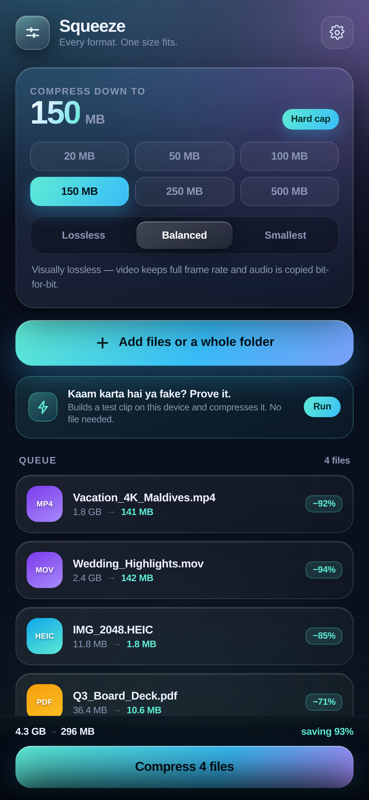
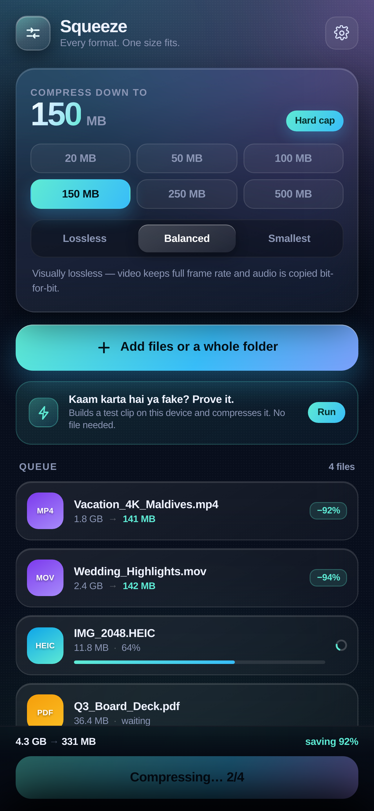
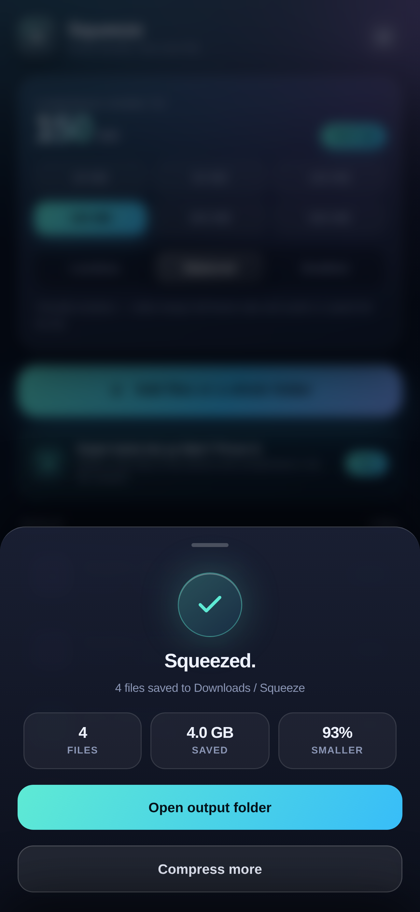
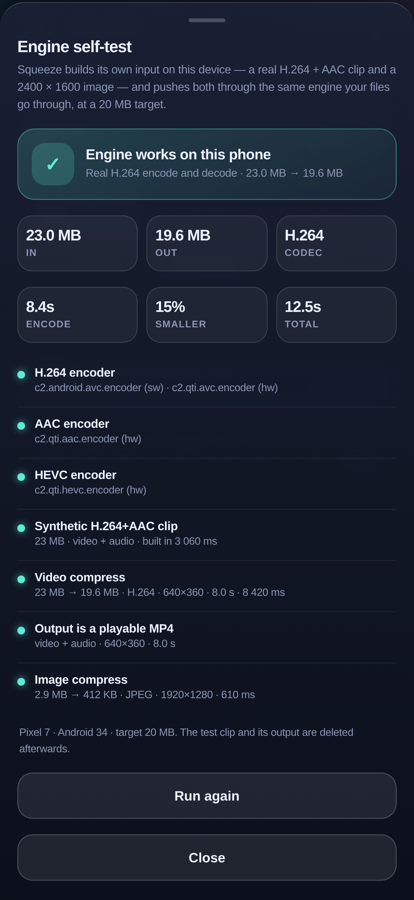
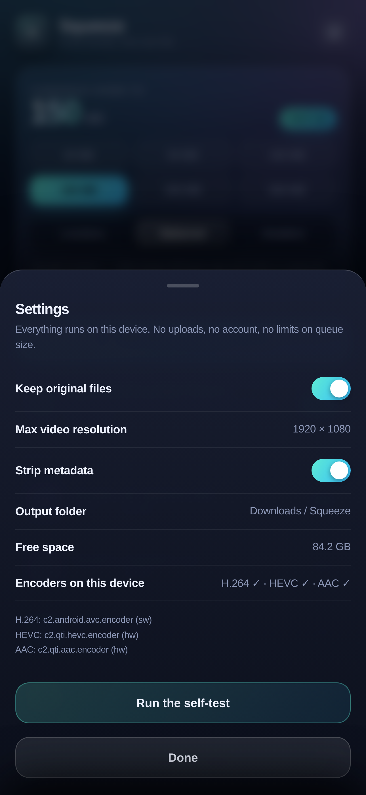

# Squeeze

**A file compressor for Android that takes any format and fits it into the size you pick — 20 MB, 150 MB, whatever you need — without throwing quality away.**

Photos, 4K video, audio, PDFs, Office documents and archives all go through one queue. Pick a target, hit compress, and everything lands in `Downloads/Squeeze`. Everything runs on the phone: no uploads, no account, no ads, no file-size limits.

And you do not have to take any of that on trust: there is a **built-in self-test** that encodes a real H.264 + AAC clip on your own phone, pushes it through the same engine your files go through, and shows you the input bytes, output bytes, codec and time taken. No file picking required.

<p align="center">
  
</p>

## Screenshots

| Queue &amp; target size | Compressing | Done |
|---|---|---|
|  |  |  |

| Self-test | Settings |
|---|---|
|  |  |

## Install

Download **[Squeeze.apk](Squeeze.apk)** and open it on your phone. Android 10 or newer. You may need to allow "install unknown apps" for your browser or file manager the first time.

Signed with a release key, so future builds install straight over this one.

## What it actually does

The honest version, format by format. There is no single "compress without losing anything" switch that works on every format — anyone who tells you otherwise is either lying or quietly re-encoding your video. Squeeze picks the right strategy per file and tells you which one it used.

| Format | Lossless mode | Balanced (default) | Smallest |
|---|---|---|---|
| **JPG / PNG / HEIC / WebP** | Re-encoded losslessly (WebP lossless / PNG). Pixels are bit-identical, metadata stripped. | Quality 82, downscaled to the resolution cap, stepped down until it fits the target. | Quality 58 and smaller dimensions. |
| **MP4 / MKV / MOV / WEBM** | Copies the file untouched if it already fits; otherwise high-bitrate H.264. | H.264 re-encode sized to your target, resolution stepped down to fit. **The audio track is copied bit-for-bit** when it already fits the budget. | Lowest resolution and bitrate that still looks fine on a phone. |
| **MP3 / M4A / FLAC / WAV / OGG** | Original samples preserved, untouched. | AAC at whatever bitrate the target allows. | Same, lower bitrate floor. |
| **ZIP / DOCX / XLSX / PPTX** | Unpacked and re-deflated at level 9. Truly lossless — the bytes inside are unchanged. | Same. | Same. |
| **PDF / anything else** | Wrapped in a maximum-deflate ZIP, or stored unchanged if that would make it bigger. | Same. | Same. |

Two rules it never breaks: it will not hand you a file bigger than the one you gave it, and it will not re-encode something that already fits your target — those come back copied untouched.

**On PDFs:** embedded images inside a PDF are not recompressed, because doing that properly needs a full PDF library and would change the document's rendering. Squeeze re-deflates the container. A PDF that is mostly scanned images will barely shrink; one with uncompressed content streams can drop a lot.

## Prove it works — the self-test

Every compressor claims a lot. Squeeze ships with a button that checks it, on your hardware, in about fifteen seconds.

Tap **Run** under the add button (or *Run the self-test* in Settings). The app then:

1. Lists the encoders this device actually reports — H.264, HEVC and AAC, with the codec name and whether it is hardware or software.
2. Encodes a real H.264 + AAC clip with `MediaCodec` — 640 × 360, CBR, about 24 MB — so the input is genuinely larger than the target.
3. Compresses a synthetic 2400 × 1600 PNG the same way.
4. Pushes both through `Engine.compress` at a **20 MB target**, exactly as it would a file you picked.
5. Re-opens the result with `MediaExtractor` to prove it is a playable MP4, not just bytes on disk.

You get a pass/fail card with the measured numbers: bytes in, bytes out, the codec that did the work, the encode time and the total time. If any step fails, the card fails and names the step — the self-test never reports a pass for work that did not happen.

The test's own input and output are written to scratch space and deleted afterwards, so running it does not clutter `Downloads/Squeeze`.

## Hitting the target

The 20 / 50 / 100 / 150 / 250 / 500 MB figure is a hard cap, not a wish. Four things make that true:

1. **The budget is split before encoding.** Audio is capped at a quarter of the target (and re-encoded down if it would eat more), and whatever is left becomes the video bitrate. A two-hour video will never quietly spend 900 MB on its audio track.
2. **Resolution follows the budget.** A bitrate alone cannot put 1080p into 20 MB, so the engine picks the highest resolution whose comfortable bitrate actually fits — 1920 → 854 → 480 — instead of producing mush at full size.
3. **Every attempt is measured.** The transcode runs, the finished file is read, and if it overshoots the next attempt is scaled by the *real* overshoot.
4. **The smallest honest result wins.** If even the bottom rung cannot reach the target, you get the smallest file the footage allows and a note telling you what that floor was — never a fake "done" with nothing to show for it.

Images do the same thing by walking quality and dimension down in steps. Archives and unknown types fall back to a plain copy if compression would grow the file.

### When a target is physically impossible

A two-hour film in 20 MB is about 22 kbps of video plus audio — below anything watchable, and below the container's own overhead. Squeeze does not pretend otherwise: it encodes to the lowest sane rung and reports `Smallest reachable is 38 MB`. Short clips hit 20 MB easily; length is the limit, not the format.

## Big files

Nothing is loaded into memory whole. Inputs are streamed in 64 KB chunks, video frames go through hardware codec surfaces, and audio samples spill to a temp file with an in-memory index. A 4 GB video and a 40 KB photo use the same code path — the only real limits are free disk space and how long you are willing to watch a progress bar.

Files are read through a file descriptor rather than a content URI, which is what makes multi-gigabyte selections from Downloads, an SD card or Google Drive work; and the finished output is written to scratch space first, then moved into Downloads/Squeeze, so a long transcode cannot leave a half-written file behind. Free space is checked before the job starts rather than discovered half-way through.

If something genuinely cannot be compressed, the queue row turns red and says why — "not enough space", "no video track", "smallest reachable is X". Nothing is ever reported as done when no file was produced.

The queue is unlimited; add a hundred files and they run one after another. The screen is kept awake and a wake lock is held while a job runs, so a long transcode does not get killed when the display sleeps.

## Where files go

`Downloads/Squeeze`, via MediaStore, so they show up in Files, Gallery and any other app. No storage permission is requested — Android 10+ lets the app write to its own output folder without one. Files are written as *pending* and only published when complete, so you never see a half-finished file.

## Privacy

No `INTERNET` permission at all. The app physically cannot upload your files. No analytics, no account, no ads, no tracking.

## Build it yourself

No Gradle, no AndroidX, no dependencies — `aapt2`, `javac`, `d8` and `apksigner` directly. The whole app is about 2,000 lines, Java plus one HTML file.

```bash
export ANDROID_SDK_ROOT=/path/to/android-sdk    # needs platforms;android-34, build-tools;34.0.0
export JAVA_HOME=/path/to/jdk-17
bash android/build.sh                           # -> android/build/Squeeze.apk
```

GitHub Actions does the same thing on every push (`.github/workflows/build.yml`) and attaches the APK to the release when you push a `v*` tag.

```
android/
├── AndroidManifest.xml
├── build.sh                    # aapt2 + javac + d8 + apksigner
├── release.keystore            # demo signing key (password: squeeze123)
├── assets/index.html           # the entire UI — one file
└── java/com/squeeze/compressor/
    ├── MainActivity.java       # WebView shell, SAF picker, worker thread
    ├── Engine.java             # job model, MediaStore output, dispatch
    ├── ImageCompressor.java    # decode → scale → encode → step quality
    ├── VideoCompressor.java    # MediaCodec surface transcode + target fitting
    ├── AudioCompressor.java    # AAC re-encode
    ├── AudioBag.java           # encoded-audio spool + AAC passthrough
    ├── Archiver.java           # ZIP / Office re-deflate, generic fallback
    └── SelfTest.java           # on-device H.264+AAC clip, test image, encoder list
```

The UI is a single HTML file talking to the engine over a small JS bridge (`Native.pickFiles`, `Native.start`, `Native.selfTest`, `Native.encoders`, `Sq.onProgress`, `Sq.onDone`, `Sq.onSelfTest`), which is also why the screenshots above are the real interface rendered at phone size rather than mockups.

## Licence

MIT — see [LICENSE](LICENSE).
